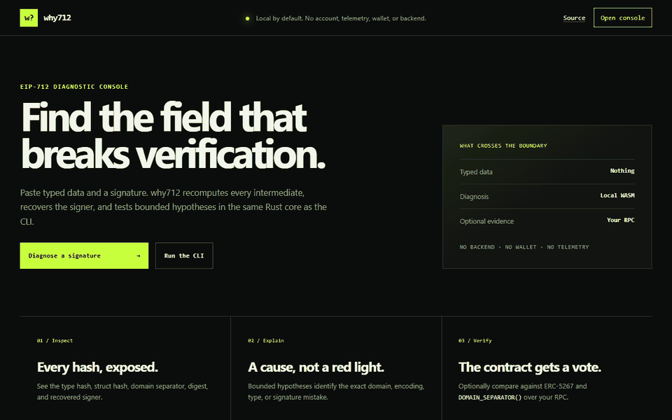

<p align="center"></p>

<h1 align="center">why712</h1>

<p align="center">
  <a href="https://github.com/PTK030/why712/actions/workflows/ci.yml"></a>
  <a href="LICENSE"></a>
</p>

<p align="center">Find out why an EIP-712 signature does not verify.</p>

<p align="center"></p>

### [Try it in your browser](https://ptk030.github.io/why712/) — no install, no backend

> **Pre-release:** the native core, CLI, browser demo, and Pages workflow are functional.
> Packaged binaries and the production Docker image belong to the next milestone.

why712 computes every EIP-712 intermediate, recovers the signer, and searches a bounded set of
common signing mistakes. When an RPC endpoint is supplied, it reads the contract's actual domain
through ERC-5267 or `DOMAIN_SEPARATOR()` and records exactly which fallback was used.

- Root-cause findings for wrong chain IDs, domain fields, field order, integer widths, packed
  encoding, unhashed dynamic values, missing `0x1901`, bare struct hashes, and `personal_sign`.
- Signature diagnostics for raw or invalid `v`, high-S malleability, zero scalars, canonical
  65-byte signatures, and compact ERC-2098 signatures.
- Text, versioned JSON, and GitHub-flavored Markdown output.
- Deterministic offline operation with no telemetry, account, or backend.
- CI exit codes: `0` match, `1` non-match, `2` usage/input/I/O error.

## Run from source

Rust 1.97 is pinned by `rust-toolchain.toml`. After cloning:

```bash
cargo run -p why712 -- examples
cargo run -p why712 -- check \
  --typed-data crates/why712-core/fixtures/examples/wrong-chain-id.json \
  --signature 0x4355c47d63924e8a72e509b65029052eb6c299d53a04e167c5775fd466751c9d07299936d304c153f6443dfa05f40ff007d72911b6f72307f996231605b915621c \
  --signer 0xCD2a3d9F938E13CD947Ec05AbC7FE734Df8DD826 \
  --chain-id 1 \
  --offline
```

Install the current checkout locally:

```bash
cargo install --path crates/why712-cli --locked
```

Once the first release is published, the install command will be `cargo install why712`.

## Run with Docker

Build the production image and run the same CLI without a host Rust toolchain:

```bash
docker build --file docker/Dockerfile --tag why712:local .
docker run --rm --network none --read-only why712:local examples
```

The final image is a non-root distroless runtime containing only the binary and its runtime
libraries. See [docker/README.md](docker/README.md) for read-only file/stdin examples, exit
codes, RPC use, and the local Anvil mainnet fork.

## Run the browser demo

The demo is a static, framework-free application over the same Rust core. Build the ignored
WASM package and copied example corpus, then serve `web/`:

```bash
node scripts/build-web.mjs
node scripts/serve-web.mjs
```

Open `http://127.0.0.1:4173/`. It provides the diagnostic form, field-by-field findings,
intermediate hashes, one-click fixtures, Markdown copy, and fragment-only share links. No
typed data is sent to a project backend; an outbound request occurs only when an RPC URL and
contract are supplied.

## Commands

```text
why712 check    Diagnose a signature, optionally enriched through RPC
why712 digest   Print canonical EIP-712 intermediate hashes
why712 examples List the bundled reproducible cases
why712 explain  Explain a stable FindingCode
```

Typed data may come from a file or stdin (`--typed-data -`). A live probe requires both
`--contract` and `--rpc`; `WHY712_RPC_URL` may supply the endpoint. `--offline` always prevents
network access, including when that environment variable is set.

```bash
why712 check \
  --typed-data permit.json \
  --signature 0x... \
  --signer 0x... \
  --contract 0x... \
  --rpc https://your-endpoint.example \
  --format json

why712 digest --typed-data permit.json --format json
why712 explain DOMAIN_CHAIN_ID_MISMATCH
```

RPC enrichment failure is printed to stderr and diagnosis continues offline. Reports that have
chain evidence include `ONCHAIN_DOMAIN_SOURCE`, so an ERC-5267, separator-only, or offline
fallback is never silent.

## What the tool does not do

why712 does not sign messages, accept private keys, submit transactions, operate a wallet, or
support non-EVM chains. For an expected contract signer, RPC mode passes the canonical digest
and complete opaque signature to ERC-1271 `isValidSignature(bytes32,bytes)`; it never assumes a
smart-account signature has an ECDSA layout.

Never provide a private key or seed phrase. Typed data and signatures may themselves contain
sensitive application data; review a report before sharing it.

## Documentation

| Document | Contents |
|---|---|
| [Diagnostic catalog](docs/diagnostics.md) | Every stable finding code, meaning, and fix |
| [Architecture](docs/architecture.md) | Crate boundaries, snapshots, RPC, ERC-5267, ERC-1271 |
| [Development](docs/development.md) | Native Rust setup, container fallback, local commands |
| [Testing](docs/testing.md) | Independent vectors, fixtures, snapshots, required checks |
| [Coding standards](docs/coding-standards.md) | Review and implementation rules |
| [Release](docs/release.md) | Versioning, verification, publishing, and rollback |
| [Security policy](SECURITY.md) | Threat model, privacy boundary, vulnerability reporting |

## Contributing

Read [CONTRIBUTING.md](CONTRIBUTING.md). The short version: keep changes focused, preserve the
pure diagnosis boundary, add tests and diagnostic documentation together, and run all four
required checks.

## License

MIT — see [LICENSE](LICENSE).
